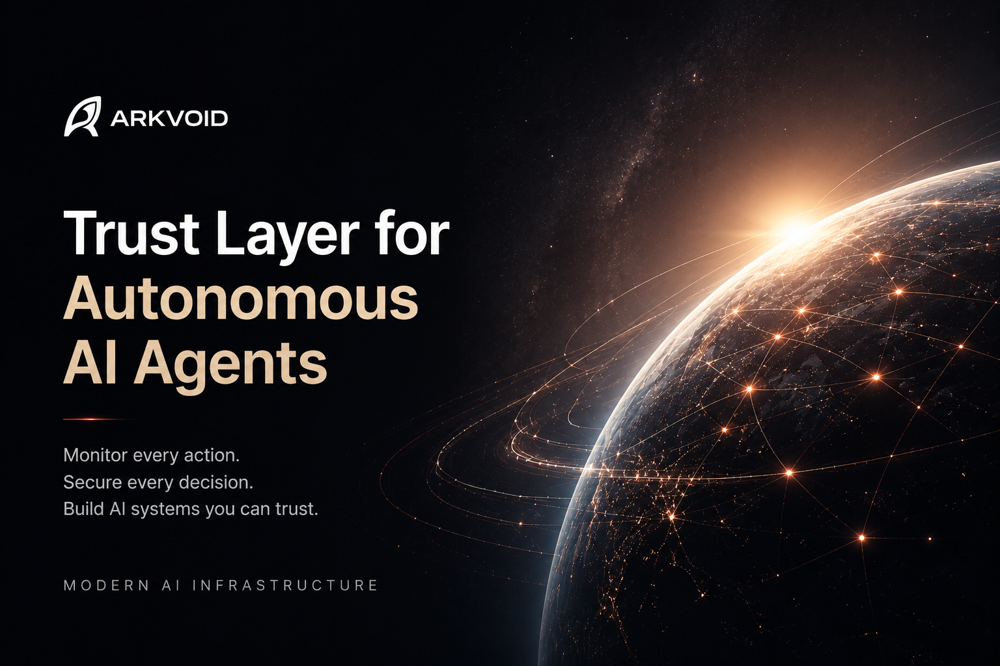

# ARKVOID

> Trust Layer for Autonomous AI Agents

Modern AI infrastructure for monitoring, tracing, governing, and securing autonomous AI systems in real time.



---

## Overview

ARKVOID is an AI observability and governance platform that helps developers build trustworthy AI systems.

As AI agents become increasingly autonomous, organizations need complete visibility into how AI makes decisions. Arkvoid provides real-time monitoring, execution tracing, audit logs, and governance infrastructure to improve transparency, accountability, and operational trust.

Inspired by emerging AI governance frameworks such as the **EU AI Act**, Arkvoid is designed to help developers deploy AI responsibly while maintaining visibility into every AI interaction.

---

# Features

## 🔍 Real-Time Agent Monitoring

Monitor every AI action from start to finish.

- Live observability
- Agent execution tracing
- Tool call monitoring
- Session tracking
- Event logging
- Workflow visualization
- Decision history

---

## 🛡 AI Governance & Trust

Build AI systems you can trust.

- Audit logs
- AI decision traceability
- Compliance reporting
- Governance dashboards
- Security visibility
- Role-based access
- Production monitoring

---

## ⚡ Modern AI Infrastructure

Designed for today's AI ecosystem.

Compatible with:

- OpenAI
- Anthropic Claude
- Google Gemini
- LangChain
- MCP
- Multi-Agent Systems
- Autonomous AI Agents

---

# Tech Stack

## Frontend

- Next.js
- React
- TypeScript
- Tailwind CSS

## Backend

- Supabase
- PostgreSQL
- Prisma
- Edge Functions

## Infrastructure

- Vercel
- GitHub
- OAuth Authentication
- Razorpay

## AI

- OpenAI
- Claude
- Gemini
- Mistral AI

---

# How Codex, GPT-5.5 & Claude Were Used

Arkvoid was developed with the assistance of modern AI coding tools throughout the software development lifecycle.

## OpenAI Codex

Used for:

- Software engineering assistance
- Code generation
- TypeScript implementation
- API development
- Debugging
- Refactoring
- Component generation
- Code optimization

## GPT-5.5 & 5.6

Used for:

- Architecture planning
- Backend design
- Database modeling
- Supabase implementation
- SQL generation
- Documentation
- Technical problem solving
- Security improvements

## Claude

Used for:

- Large codebase reasoning
- Refactoring complex modules
- Explaining unfamiliar technologies
- Debugging production issues
- Reviewing implementation approaches
- Writing technical documentation
- Improving maintainability

## Other AI Tools

- Google AI Studio (Gemini)
- Mistral AI

These AI models acted as engineering collaborators throughout development, accelerating learning, prototyping, debugging, and implementation while all architectural decisions, product direction, and integration choices remained under my control.

---

# Development Story

Arkvoid is a solo-built project.

I'm not a traditional software developer. Instead, I learned by building real products with modern AI coding tools.

A unique aspect of this project is that **most of Arkvoid was designed, developed, tested, and deployed using an Android phone**, together with cloud development tools such as GitHub, Supabase, and Vercel.

This project demonstrates how AI-assisted development can significantly reduce barriers to building sophisticated software.

---

# Why Arkvoid?

The future of AI depends on trust.

As autonomous AI agents become more capable, developers need infrastructure that provides transparency, accountability, and observability by default.

Arkvoid aims to become the trust layer that enables organizations worldwide to deploy AI safely, responsibly, and confidently.

---

# Quick Start

Install the SDK:

```bash
npm install arkvoid
```

Import:

```ts
import { Arkvoid } from "arkvoid";
```

Initialize:

```ts
const arkvoid = new Arkvoid({
  apiKey: process.env.ARKVOID_API_KEY,
});
```

Create a trace:

```ts
await arkvoid.trace({
  agent: "customer-support-agent",
  action: "answer_question",
  status: "success",
  metadata: {
    provider: "OpenAI",
    model: "gpt-5.5",
  },
});
```

---

# Roadmap

- AI policy enforcement
- Enterprise governance
- Multi-agent observability
- Compliance automation
- AI security analytics
- Advanced dashboards
- SDK improvements
- Additional framework integrations

---

# Vision

Our vision is to build the trust infrastructure for autonomous AI.

Just as cloud platforms rely on monitoring and observability, the next generation of AI systems will require governance, accountability, and transparency.

Arkvoid aims to provide that foundation.

---

# Links

🌐 Website: https://arkvoid.com

📦 NPM: https://npmjs.com/package/arkvoid

💻 GitHub: https://github.com/arkvoidai

---

## License

MIT License
